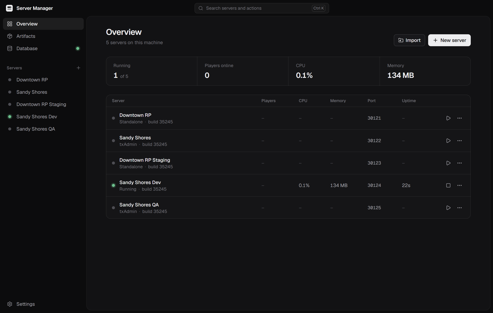
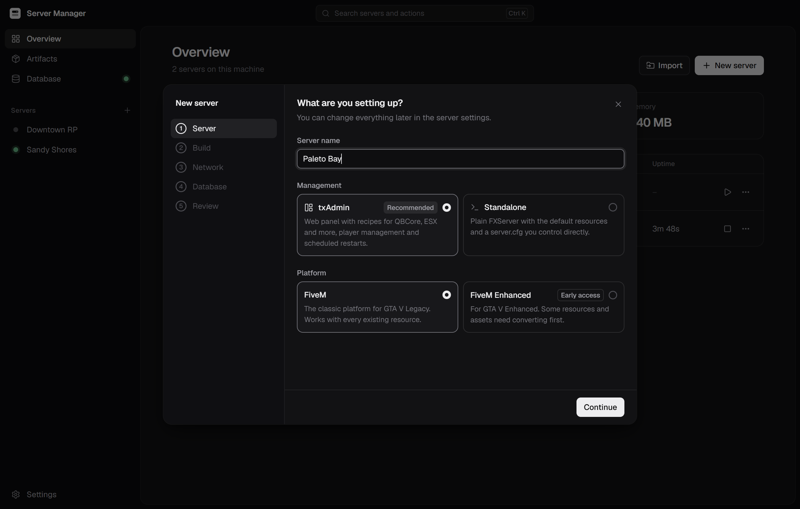
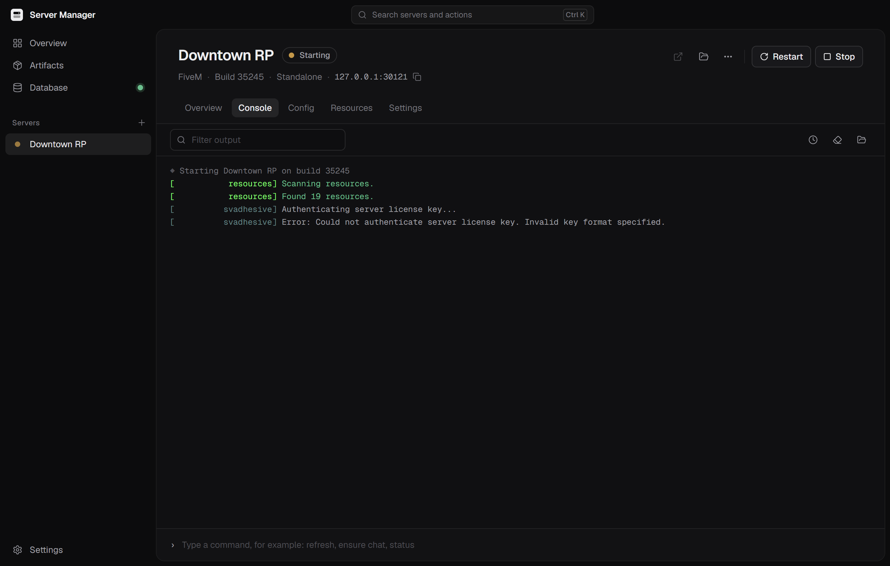
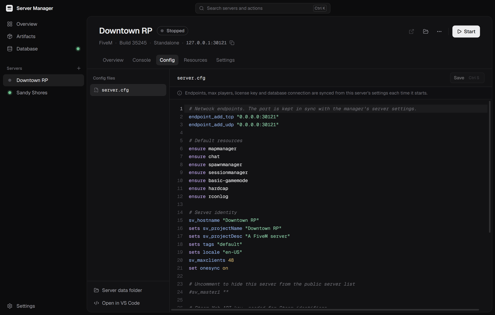
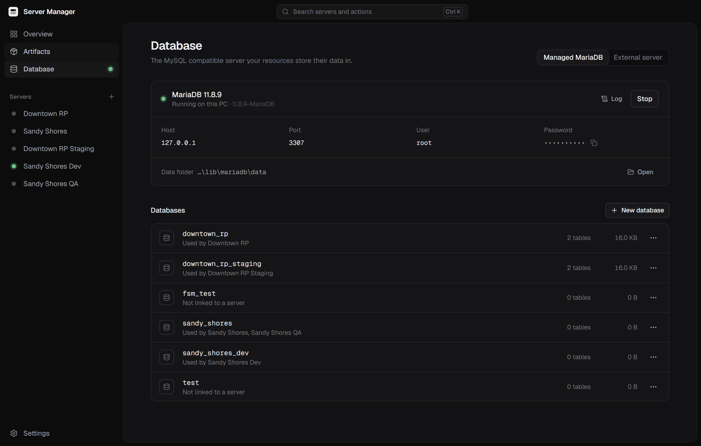

<p align="center">
  
</p>

<h1 align="center">FiveM Server Manager</h1>

<p align="center">
  Run, manage and duplicate any number of FiveM servers on one Windows PC.<br />
  Builds, txAdmin, databases and ports are handled for you.
</p>

<p align="center">
  <a href="https://github.com/Mas-inx/fivem-server-manager/releases/latest"></a>
  <a href="https://github.com/Mas-inx/fivem-server-manager/actions/workflows/ci.yml"></a>
  <a href="LICENSE"></a>
</p>

<p align="center">
  
</p>

## Why

Running more than one FiveM server on the same machine usually means juggling artifact folders, `start.bat` files, colliding ports, a shared txData that keeps overwriting `admins.json`, and a XAMPP install nobody remembers configuring. This app puts all of that behind one window.

## Features

**Servers**
- Create a server in a short wizard: pick txAdmin or standalone, a build, ports and a database
- Run as many servers side by side as your PC can handle; ports are picked so they never collide
- Start, stop and restart individually or all at once, from the app or the tray
- Live CPU, memory, player count and uptime per server, with small history graphs
- Automatic restart on crash, with a back-off that pauses after repeated crashes
- Start chosen servers when the app opens, and the app when Windows starts
- Duplicate a server in one click, including its txAdmin data and (optionally) a full copy of its database
- Import existing servers from a `server-data` folder or a `txData` folder, in place or copied

**Admins and shared config**
- Add someone once and they are an admin on every server: in game through `add_principal`, and in txAdmin's panel on txAdmin servers
- Pick admins straight from the players online on any of your servers, or paste their identifiers
- Choose the permission group (`group.admin`, `qbcore.god`, …)
- Shared config lines every server runs, such as a Steam Web API key, tags or extra ace rules
- Each server can opt out in its settings

**txAdmin**
- Each server gets its own txData, port and admin account through txAdmin's `TXHOST_*` variables
- The admin account is created on first boot and you are signed in automatically
- The txAdmin panel opens inside the app, with its own isolated session per server
- Database and license key are prefilled in txAdmin's recipe deployer (QBCore, ESX, Qbox, …)

**Builds (artifacts)**
- Download the Recommended, Latest or any specific FXServer build straight from Cfx.re
- Support for both FiveM and FiveM for GTA V Enhanced builds
- Builds are downloaded once and shared by every server that uses them
- Shows support status and which servers use each build; unused builds can be removed

**Database**
- One click installs a private MariaDB LTS that runs on 127.0.0.1 only, without a Windows service
- Or connect to an existing MySQL/MariaDB (XAMPP, Laragon, remote)
- If port 3306 is already taken, the app offers a free port or to connect to what is there
- Create, clone and drop databases; copy connection strings; open in HeidiSQL if installed
- `mysql_connection_string` is written into `server.cfg` for you

**Everyday tools**
- Console with ANSI colours, filtering, timestamps and command history
- `server.cfg` editor with syntax highlighting and Ctrl+S
- Resource list with on/off switches that edit `ensure` lines, plus refresh and per-resource restart, applied live on standalone and txAdmin servers
- Command palette (Ctrl+K) for jumping to servers and running actions
- Dark and light themes, native Windows title bar controls and snap layouts
- Updates itself from GitHub Releases: new versions download in the background and install when you restart

<p align="center">
  
  
  
  
</p>

## Install

Download `FiveM-Server-Manager-<version>-Setup.exe` from the [latest release](https://github.com/Mas-inx/fivem-server-manager/releases/latest) and run it. Windows 10 or 11 (64-bit) is required.

The installer is not code-signed yet, so Windows SmartScreen may say it protected your PC. Choose **More info**, then **Run anyway**.

The first time you open the app it asks where to keep your **library**: the folder that holds servers, downloaded builds and the managed database. A short path without spaces, such as `C:\FXServers`, works best.

You will need a free license key per running server from [portal.cfx.re](https://portal.cfx.re/servers/registration-keys).

## How it works

```
<library>/
├── artifacts/
│   ├── legacy/<build>/FXServer.exe      shared by every server on that build
│   └── enhanced/<build>/cfx-server.exe
├── servers/
│   └── <server>/
│       ├── server-data/                 standalone servers: resources + server.cfg
│       ├── txData/                      txAdmin servers: this server's own txAdmin data
│       └── logs/                        console output, one file per day
└── mariadb/                             managed MariaDB binaries and data
```

- **txAdmin servers** are launched with `TXHOST_DATA_PATH`, `TXHOST_TXA_PORT` and `TXHOST_FXS_PORT` so every server has an isolated txData and fixed ports. On first boot `TXHOST_DEFAULT_ACCOUNT` seeds the admin account, and `TXHOST_DEFAULT_DB*` / `TXHOST_DEFAULT_CFXKEY` prefill the deployer.
- **Standalone servers** are launched with `+exec server.cfg`. Before each start the endpoint port, `sv_maxclients`, `sv_licenseKey` and `mysql_connection_string` are synced from the server's settings; everything else in the file is left as you wrote it.
- Builds come from the official Cfx.re changelog API and download page.
- Settings live in `%APPDATA%\FiveM Server Manager\library.json`. Passwords and license keys are encrypted with Windows DPAPI through Electron's `safeStorage`.
- Universal admins and shared config are written to a managed `server-manager.cfg` that each `server.cfg` execs. txAdmin panel accounts are merged into `admins.json` only while that server is stopped, because txAdmin restores the file if it changes while running; the master account and admins created inside txAdmin are never touched.
- Resource commands reach standalone servers through their console and txAdmin servers through txAdmin's own API, signed in with the server's txAdmin account.
- Updates come from GitHub Releases through electron-updater, which reads `latest.yml` from the newest release.
- Deleting a server only ever removes folders inside the library, and moves them to the Recycle Bin.

## Development

Requires Node.js 22 or newer.

```bash
npm install
```

```bash
npm run dev
```

```bash
npm run typecheck
```

To build an installer into `dist/`:

```bash
npm run dist
```

### Releasing

Releases are built by GitHub Actions. Bump the version and push the tag:

```bash
npm version patch
```

```bash
git push --follow-tags
```

The [release workflow](.github/workflows/release.yml) checks that the tag matches `package.json`, builds the installer on Windows and publishes a GitHub Release with generated notes. Tags with a hyphen, such as `v0.2.0-beta.1`, are marked as pre-releases.

### Environment variables

Two environment variables help when working on the app:

| Variable | Effect |
| --- | --- |
| `FSM_USER_DATA` | Use a different profile folder, so development never touches your real servers |
| `FSM_DEBUG_PORT` | Expose the Chromium remote debugging port for automated UI checks |
| `FSM_UPDATE_URL` | Point the updater at a local folder served over HTTP (with `latest.yml` and an installer) to test updates |

### Project layout

```
src/
├── main/                 Electron main process
│   ├── services/
│   │   ├── artifacts.ts  build catalogue, download and unpacking
│   │   ├── runner.ts     process supervision, logs, crash handling, health checks
│   │   ├── servers.ts    create, import, duplicate, files and resources
│   │   ├── database.ts   managed MariaDB and MySQL access
│   │   ├── cfg.ts        server.cfg parsing and rewriting
│   │   ├── stats.ts      CPU and memory sampling
│   │   └── ports.ts      port checks and allocation
│   ├── ipc.ts            renderer API handlers
│   └── index.ts          window, tray and lifecycle
├── preload/              typed bridge exposed as window.api
├── renderer/             React UI (Tailwind CSS, Radix primitives, CodeMirror)
└── shared/               types and the API contract shared by both sides
```

Stack: Electron, React, TypeScript, Vite (electron-vite), Tailwind CSS, Radix UI, Zustand, CodeMirror, mysql2.

## Contributing

Issues and pull requests are welcome. Please run `npm run typecheck` before opening a PR, keep UI changes consistent with the existing components in `src/renderer/src/components/ui`, and describe how you tested anything that starts or stops processes.

## Disclaimer

This project is not affiliated with or endorsed by Cfx.re, Rockstar Games or Take-Two Interactive. FiveM and txAdmin are their respective owners' projects; this app downloads them from official sources and does not redistribute them. Use of FiveM is subject to the [Cfx.re terms](https://fivem.net/terms).

## License

[MIT](LICENSE)
